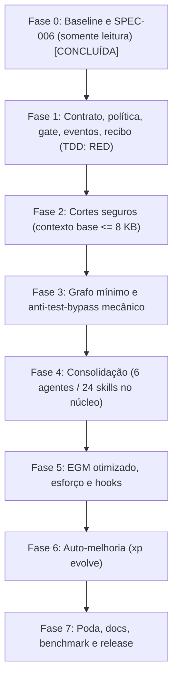

# SPEC-006: XP Multi-Agent Kit v4 — "Thin Harness" & Autonomous Self-Evolution

**Status:** APPROVED (Stop Gate de spec pré-autorizado — missão L2)
**Risco:** L2 (refatoração arquitetural do harness, otimização de tokens, gate determinístico)
**Autor:** Antigravity (Pair Navigator & Orchestrator)
**Data:** 2026-11-01
**Branch:** `refactor/thin-harness` (partindo de `v3.9.2-baseline`)
**Arquivo:** `.agents/specs/SPEC-006-THIN-HARNESS.md` — **fonte única** desta missão (não manter planos paralelos).

---

## 0. Regras de Execução

Esta missão é L2. O Stop Gate de spec é pré-autorizado. Essa pré-autorização vale **exclusivamente** para `approve_spec` e **nunca** cobre ações sem desfazer (tier `human` em `.agents/policy.yaml`).

1. **Sem subagentes nem revisão LLM-goldfish.** Proibido despachar subagentes (`invoke_subagent`) e rodar revisores LLM. Usar apenas CLIs determinísticos: `xp-spec validate`, `xp-goldfish --check-readiness|--check-code|--multipass`, `xp-conformance`.
2. **Esforço por evidência.** `high` somente nas Fases 0 e 3; `medium` no restante; `low` em edição mecânica.
3. **Execução sequencial.** Uma fase por vez na branch `refactor/thin-harness`. Fim de fase: testes verdes → commit atômico → relatório de ≤15 linhas → próxima fase. `PROJECT_MEMORY.md` é atualizado somente no fim de cada fase.
4. **Sem perguntas abertas.** Decidir pelo padrão indicado neste documento e registrar em "Decisões Arquiteturais" (≤20 linhas).
5. **Circuit breaker do executor.** Mesma falha duas vezes (mesmo erro, mesma causa aparente) = parar e reportar; não tentar uma terceira vez. Outros motivos de parada: ACs em conflito; operação destrutiva fora do repositório.
6. **Prevalência do repositório.** Confirmar cada fato da Seção 2 no repositório antes de agir. Se divergir, vale o repositório; registrar a divergência.
7. **Idioma.** Toda resposta ao usuário em português (PT-BR); arquivos internos do kit (config, código, skills) em inglês conciso.
8. **Comando de baseline.** `git tag v3.9.2-baseline && python3 -m unittest discover tests` (executado: 385 testes aprovados).
9. **Projetar a partir do meio.** O gate (Fase 1) precisa existir e estar testado antes de qualquer corte em prosa. Nenhuma regra textual é removida antes de o mecanismo que a substitui passar nos testes. A coluna "Fase em que a prosa sai" da Seção 12 é obrigatória e vincula cada corte à fase do seu mecanismo.
10. **Registro imediato em `components.yaml`.** Todo componente novo entra em `.agents/components.yaml` desde a Fase 1, com `prevents:` e critério de remoção (P7).

---

## 1. Princípios de Engenharia de Harness

| Camada | Função | Kit hoje (v3.9.2) | Kit v4 ("Thin Harness") |
|---|---|---|---|
| Harness | O que o agente pode fazer, estado e limites | Gordo: regras em prosa repetidas em 8–14 arquivos | Fino: `AGENTS.md` ≤3 KB; o resto vira código e política |
| Loop | Verificação honesta e auditável | Auto-auditoria de 5 pontos em prosa (o modelo diz "pronto") | `xp gate` determinístico, evidência em escada |
| Graph | Ordem de execução e quem decide | 11 workflows em prosa, 3 orçamentos conflitantes, risco rotulado pelo modelo | `workflow.yaml` mínimo + `policy.yaml` imposta por código |
| Learning | Melhoria com o uso | Lições `[L-NNN]` manuais | `xp evolve`: lição vira restrição na camada dona, com evidência |

**Oito regras canônicas**

- **P1 — Thin harness, fat code (escada de instrução).** Explicação → checklist → template → checagem automática → política imposta. Cada regra sobe o máximo possível; ao subir, sai da prosa. Teste, hook ou script resolve? Não vira texto.
- **P2 — Contrato antes de agir.** Responde a cinco perguntas: (1) resultado esperado; (2) escopo permitido; (3) o que não pode mudar; (4) evidência de conclusão; (5) o que exige aprovação humana.
- **P3 — Pronto = evidência.** Do mais forte ao mais fraco: determinístico (testes exit 0, tipos, schema) > observável (o traço prova que rodou) > independente (revisor em contexto separado) > auto-relato (**nunca conta**). Checagem mais barata primeiro, para na primeira falha. Onde código responde, não use modelo.
- **P4 — O modelo rotula, o código decide o que o rótulo libera.** O nível de autorização vem de caminhos e comandos reais, não do que o modelo declarou. Atenção humana só onde não há como desfazer (`human`).
- **P5 — Falha tem classe e muda uma condição.** Retry idêntico é repetição, não recuperação. Mesma assinatura duas vezes = parar e escalar ao operador.
- **P6 — Lição é restrição de 1 linha na camada dona.** Sem transcrição de log no contexto. Lição na camada errada vira conselho.
- **P7 — Cada componente paga aluguel e declara o que previne (`prevents:`).** Se a falha que ele previne não ocorre mais em N sessões, ele sai. Construir para apagar.
- **P8 — Grafo mínimo.** A maioria das tarefas termina no nível "loop com feedback". Só se sobe de nível quando a falha atual custar mais que construir o próximo.

---

## 2. Fatos Medidos no Repositório (v3.9.2-baseline) e Divergências

1. **Contexto fixo base por turno: 23.525 B (~6.000 tokens).** `AGENTS.md` 5.930 B + `PROJECT_MEMORY.md` 6.674 B + `SKILLS_INDEX.md` 8.679 B + `token-economy.md` 2.242 B (lido hoje sempre no início).
2. **Frontmatters das skills:** 15.214 B de conteúdo entre os delimitadores `---` (15.854 B incluindo delimitadores). Método padronizado: bytes de conteúdo limpo (15.214 B ≈ 15,2 KB). O valor de 15.189 B do prompt é da mesma ordem de grandeza.
3. **Catálogo:** 80 skills ativas (155.873 B). `goldfish-spec-review/SKILL.md` = 6.015 B (acima do teto de 6.000 B).
4. **Segurança:** 14 skills no disco (0,7–2 KB): `api-security`, `authentication-security`, `authorization-security`, `availability-security`, `cloud-security-and-zero-trust`, `container-security`, `crypto-guardian`, `privacy-review`, `secrets-guardian`, `security-observability`, `security-sentinel-review`, `security-testing`, `supply-chain-security`, `threat-modeling`. `ci-security-gate` é contada em release (`release-and-deploy`). As 14 consolidam-se em 3 skills no núcleo.
5. **Repetições em prosa (divergências do prompt; prevalece o repositório):** "Completeness Over Speed" em 10 arquivos (prompt: 8); "Heilmeier" em 17 (12); "EGM Pass" em 13 (12); "Stop Gate" em 18 (14); `PROJECT_MEMORY.md` em 63 (35).
6. **Orçamentos de turno conflitantes:** `task-routing/SKILL.md` declara 3/8/20; workflows declaram 3/8; `token-economy.md` e `kit_constants.py` declaram 5/25/100/None.
7. **Workflow L0:** `trivial.md` exige `archivist` gravando `PROJECT_MEMORY.md` mesmo em typo.
8. **Sem gates mecânicos:** risco L0–L3 inferido pelo modelo sem conferir o diff; anti-test-bypass só em prosa; "pronto" depende de auto-auditoria de 5 pontos.
9. **Hook dinâmico:** `dynamic_effort_hook.py` troca o perfil de skills por symlink (`sync_dynamic_skill_profile`) e reescreve settings a cada prompt (`sync_global_settings`) — confirmado no código. O impacto no cache de prefixo é provável e será medido no benchmark.
10. **Superfície de ferramentas:** CLIs duplicados `xp-*`/`agy-*` (aliases gerados por `kit_installer.py`); `code-review-graph` exigido sem fallback; compressores sobrepostos (`tool-size-guard`, `smart_tool_optimizer` de 27.964 B, `context_compactor`, `agy-sanitize`, `output_noise`).
11. **Inconsistências cadastrais:** `README.md` v3.1 vs `AGENTS.md` v3.9; skills contadas como 77/79/80; descrição de `goldfish-spec-review` quebrada (`>-`) no `SKILLS_INDEX.md`; `REPO_MAP.md` cita `token_tracker.py` inexistente.
12. **Instalador:** `kit_installer.py` copia as pastas `policies, rules, workflows, templates, skills, agents` e não envia `specs`, `memory/archive` nem `HISTORY.md`; precisa de blindagem contra vazamento de arquivos de desenvolvimento e de suporte a packs, stubs e `policy.yaml`.
13. **Hosts:** `host_adapters.py` provisiona 6 alvos (`antigravity`, `opencode`, `cursor`, `qoder`, `codex`, `claude`). Os **5 hosts nativos** do kit são antigravity, opencode, cursor, qoder e codex; o adaptador `claude` (`CLAUDE.md`, `.claude/agents/*.md`) também tem de continuar funcionando.

---

## 3. Contexto, Problema e Catecismo de Heilmeier

- **Objetivo.** Transformar o kit em um "Thin Harness" determinístico: contexto base fixo de ~23,5 KB para ≤8 KB e menos tokens de execução, **sem perder** TDD estrito, rastreio AC→teste, release gate bloqueante, STRIDE em L3 e anti-test-bypass mecânico.
- **Como isso é feito hoje (estado atual).** Harness gordo: regras em prosa repetidas em 8–14 arquivos; 23.525 B de contexto por turno; 80 skills (155 KB), 11 agentes e CLIs duplicados; "pronto" por auto-auditoria do modelo; risco L0–L3 rotulado pelo modelo.
- **O que há de novo.** Escada de instrução (P1–P8): contrato e estado (`xp_contract.py`), política por custo de desfazer (`policy.yaml`), gate barato-primeiro (`xp_gate.py`), eventos locais (`kit_events.py`), contexto ≤8.000 B com `token-economy.md` fora do contexto fixo, CLI única `xp`, grafo mínimo (`workflow.yaml` + `xp_flow.py`) com congelamento SHA-256 dos testes RED, 6 agentes, núcleo de 24 skills com packs opcionais, e `xp evolve`.
- **Quem se importa.** Quem opera o kit em Antigravity, OpenCode, Cursor, Codex, Qoder e Claude: menos regras concorrentes, menos exaustão de contexto e verificação por software com recibo de handoff.
- **Riscos e custos.**
  - Regressão nos 385 testes → mitigado por "projetar a partir do meio".
  - Incompatibilidade em hosts/automações legadas → shims `xp-*`/`agy-*` deprecados por uma versão.
  - Custo de governança de componentes → `kit_lint.py` e `xp evolve`.
- **Métricas de sucesso.**
  - Contexto base fixo ≤8.000 B (`AGENTS.md` ≤3.000 + `PROJECT_MEMORY.md` ≤3.000; `token-economy.md` sob demanda).
  - 100% dos testes das funcionalidades mantidas aprovados (baseline 385; removidos justificados em `REMOVED.md`).
  - 6 agentes; núcleo de 24 skills (≤36); frontmatters somados ≤6.000 B.
  - `xp gate` com veredito determinístico e recibo em PT-BR; `xp-goldfish --check-readiness` e conformidade em 100%.
  - **Meta de referência (proposta, ainda não medida):** menos tokens totais por tarefa aceita, a apurar por `docs/BENCHMARK.md`.

---

## 4. Alternativas Consideradas

1. **A (rejeitada):** só encurtar prosa e policies. Mantém o modelo fiscalizando a si mesmo; atalhos voltam.
2. **B (rejeitada):** framework externo (LangChain, CrewAI, AutoGen). Viola platform-native e "zero dependências novas"; adiciona latência e depuração opaca.
3. **C (escolhida):** Thin Harness com escada de instrução, gate em código, grafo mínimo e política por custo de desfazer. Ataca a causa raiz (instrução em texto) com scripts leves (P1) e verificação por evidência (P3).

---

## 5. Roteiro Fásico e Mapeamento de ACs

### Fase 0 — Baseline e plano (somente leitura) [CONCLUÍDA]
Tag `v3.9.2-baseline`; testes (385 PASS); `python3 scripts/skill_index.py audit`; confirmação da Seção 2; geração deste SPEC (ACs, Seção 8 de merge, Seção 11 "Decisões", Seção 12 escada de regras); validação só com `xp-spec validate` e `xp-goldfish --check-readiness`.

### Fase 1 — Contrato, política, gate, eventos e recibo (TDD: RED primeiro)
Mapeamento: AC-1, AC-2, AC-3, AC-4, Regra 10.
1. `scripts/xp_contract.py` (≤150 linhas) + `tests/test_xp_contract.py`; estado em `.agents/runtime/run.json` (gitignored). (AC-1)
2. `.agents/policy.yaml` (≤40 linhas) com tiers `auto|review|human`; hook PreToolUse `scripts/hooks/pre_tool_guard.py`; `xp approve <id>`; fallback `xp-run`. (AC-2)
3. `scripts/xp_gate.py` (≤300 linhas) + `tests/test_xp_gate.py`: 10 degraus barato-primeiro, veredito de uma linha, exit codes 0/1/2/3, bloco de falha ≤30 linhas, `ESCALATE`, `--sync-memory`, `--receipt`. (AC-3)
4. `scripts/kit_events.py` (≤100 linhas) + `tests/test_kit_events.py`. (AC-4)
5. **Esqueleto de `scripts/xp`** despachando `contract`, `gate` e `approve` (os 9 subcomandos completos entram na Fase 2), para que AC-2 e AC-3 sejam testáveis pela CLI final.
6. Criar `.agents/components.yaml` (≤120 linhas, fora do contexto) e registrar cada componente novo com `id, kind, prevents, added, review_by`. (Regra 10)

### Fase 2 — Cortes seguros (contexto base ≤ 8.000 B)
Mapeamento: AC-5, AC-6. **Só sai da prosa o que já tem mecanismo testado (Seção 12).**
1. `AGENTS.md` ≤3.000 B em 8 seções que apontam mecanismos; `xp-kit doctor` falha se faltar mecanismo. Regras cujo mecanismo só nasce na Fase 3 (Stop Gate, anti-test-bypass, orçamentos via `workflow.yaml`) ficam como **1 linha cada** até a Fase 3. (AC-5)
2. `PROJECT_MEMORY.md` ≤3.000 B em FATOS, DECISÕES (com motivo), PROGRESSO, LIÇÕES (+ lista `never`), data por linha, rotação via `memory_archiver`. (AC-5)
3. `token-economy.md` sai do contexto fixo: limites numéricos vão para `kit_constants.py` (e só para `workflow.yaml` na Fase 3); diretrizes mecânicas, para policies sob demanda. (AC-5)
4. `SKILLS_INDEX.md` deixa de ser carregado (gerado em `runtime/` sob demanda); corrigir o bug `>-`; `REPO_MAP.md` gerado sob demanda. (AC-5)
5. Remover "Completeness Over Speed" e `COMPLETENESS_OVER_SPEED`; novo critério: pronto = ACs rastreados + gate PASS. Fundir as 12 policies em ≤7 arquivos (fusão, sem perder regras ainda sem mecanismo). (AC-5)
6. Fonte única: `scripts/kit_lint.py` + `tests/test_kit_lint.py`; `VERSION` = `4.0.0`; contagens geradas por script. (AC-6)
7. `scripts/xp` completo (9 subcomandos); shims `xp-*`/`agy-*` deprecados (gerados em `kit_installer.py`); instalador blindado contra arquivos de desenvolvimento. (AC-6)

### Fase 3 — Grafo mínimo e anti-test-bypass mecânico
Mapeamento: AC-7. Esforço `high`.
1. `.agents/graph/workflow.yaml` (≤150 linhas) + `scripts/xp_flow.py` (≤250 linhas) + `tests/test_xp_flow.py`. (AC-7)
2. Fluxos por composição: L0–L3, bugfix, design, migration, incident, release. `soft_turns` recebem os orçamentos de `kit_constants.py`. (AC-7)
3. Congelamento SHA-256 na saída de `red`; bloqueio de edição/remoção no gate; testes novos permitidos; `xp flow reopen <nó> --reason`. (AC-7)
4. Trava humana `approve_spec` (L2/L3); nó opcional `dispatch` (`independent_units >= 2`). (AC-7)
5. Comandos `validate`, `start`, `next` (≤800 B), `advance`, `reopen`, `where`; estado em `runtime/flow_state.json`. (AC-7)
6. Gerar stubs finos dos hosts a partir do YAML e **só então** apagar os 11 `.agents/workflows/*.md`. (AC-7)
7. Com os testes dos mecanismos verdes, remover da prosa as linhas de Stop Gate, anti-test-bypass e orçamentos marcadas "Fase 3" na Seção 12.

### Fase 4 — Consolidação estrutural (agentes e skills)
Mapeamento: AC-8.
1. 11 agentes → 6: `orchestrator` (absorve `navigator` e `genesis` como nó `bootstrap`), `builder` (absorve `test-guardian`), `reviewer` (`refactor-warden` + `release-gatekeeper`), `sentinel`, `designer`, `shipper`; `archivist` descontinuado em favor de `xp gate --sync-memory`.
2. 80 skills conforme a Seção 8: 24 no núcleo (≤36), frontmatters somados ≤6.000 B, cada `SKILL.md` ≤3.500 B com `sections/` sob demanda; apêndice de regras descartadas neste SPEC.
3. `.agents/packs/` (packs `design` [OpenDesign opt-in], `marketing`, `brutalist`, `roadmapping`) via `xp kit pack enable <nome>`.
4. RTK e `code-review-graph` mantidos, com **fallback sem bloqueio** para o segundo; perfil estático por stack; remover `sync_dynamic_skill_profile`.
5. Preencher `components.yaml` para todos os componentes mantidos; `kit_lint` falha se faltar entrada ou `prevents`.

### Fase 5 — EGM otimizado, esforço e hooks
Mapeamento: AC-9.
1. Personas 9 → 2 (`spec_reviewer`, `code_reviewer`, ≤2 KB cada), rubrica de refutação, sem A/B nem synthesizer.
2. EGM em 3 passes com LLM só onde paga; `EGM_LLM_REVIEW` e `XP_EGM_LLM`.
3. Esforço por evidência; `agy_effort_router.py` ≤150 linhas.
4. Hook PreInvocation ≤400 B efêmeros, sem reescrever settings.
5. Compressores: manter RTK + `tool-size-guard` + `smart_tool_optimizer`; fundir `output_noise`; remover `context_compactor` e `agy-sanitize` só com prova.

### Fase 6 — Auto-melhoria por evidência (`xp evolve`)
Mapeamento: AC-10. `scripts/xp_evolve.py` (≤350 linhas, sem rede e sem LLM), `report`/`propose`/`apply`, escada de promoção, teste do nível 7, ablação condicional, `lesson-learned` com `signature`/`layer`/`fix_type`, fixtures completas.

### Fase 7 — Poda, docs, benchmark e release
Mapeamento: AC-11, AC-12, AC-13.
1. Auditoria de `scripts/*` por evidência de uso; sem referência real → `contrib/` ou apagar.
2. `scripts/xp_session.py` consolida `session_compactor`, `session_resumer` e `agy-handoff`.
3. `antigravity_multiagent.py` e `multiagent_drivers.py` opt-in via nó `dispatch`; adaptadores dos hosts mantidos.
4. `README.md` ≤120 linhas; `xp kit doctor lint`.
5. `scripts/xp_eval.py` (`xp kit eval compare a.jsonl b.jsonl`), `tests/evals/tasks.jsonl`, `docs/BENCHMARK.md` ≤40 linhas.
6. Verificação integral de invariantes e da suíte (AC-13).

---

## 6. Tabela de Arquivos

| Arquivo alvo | Operação | Mudança e contratos |
|---|---|---|
| `scripts/xp_contract.py` | Create | Gerencia `.agents/runtime/run.json` com `risk, goal, acs, scope_files, constraints, approval_required, verify_cmd, checks, max_attempts, refactor, tried, known, next, never`. Funções `init_contract()`, `load_contract()`, `record_dead_end()`. ≤150 linhas. |
| `.agents/runtime/.gitignore` | Create | Ignora estado efêmero: `run.json`, `events*.jsonl`, `flow_state.json`, `approvals.json`. |
| `.gitignore` (raiz) | Modify | Acrescenta `.agents/components.local.yaml`. |
| `.agents/policy.yaml` | Create | Matriz `auto|review|human` por custo de desfazer. ≤40 linhas; padrões por stack gerados pelo instalador. |
| `scripts/hooks/pre_tool_guard.py` | Create | Hook PreToolUse: nega escrita do agente em `policy.yaml` e `approvals.json`, nega a invocação de `xp approve` pelo agente e bloqueia comandos `human` sem aprovação. |
| `scripts/kit_events.py` | Create | JSONL em `.agents/runtime/events.jsonl`: ≤300 B/linha, rotação 1 MB, texto truncado em 200 caracteres, local, `XP_EVENTS=0` desliga. Tipos `node, gate, approval, failure, usage, cost`. `signature = sha1(tool + 1ª linha de erro normalizada)[:10]`. ≤100 linhas. |
| `scripts/xp_gate.py` | Create | 10 degraus barato-primeiro; veredito de uma linha; exit 0/1/2/3; bloco de falha ≤30 linhas; `--sync-memory`; `--receipt` (7 campos, PT-BR). ≤300 linhas; reutiliza `audit_code_completeness`, `conformance_report`, `evidence_recorder`, `memory_archiver`. |
| `.agents/components.yaml` | Create | `id, kind, prevents, added, review_by` por skill, agente, policy, hook e persona. ≤120 linhas; não carregado no contexto; criado na Fase 1. |
| `scripts/kit_lint.py` | Create | Conta ocorrências de conceitos em prosa, valida `components.yaml`, orçamentos, versão e contagens. |
| `scripts/xp` | Create | Esqueleto na Fase 1 (`contract`, `gate`, `approve`); completo na Fase 2 com `contract\|gate\|flow\|evolve\|kit\|memory\|context\|approve\|run`. |
| `scripts/xp_eval.py` | Create | Implementa `xp kit eval compare a.jsonl b.jsonl` (métrica principal: tokens totais / tarefas com gate PASS). |
| `.agents/graph/workflow.yaml` | Create | Fluxos L0–L3, bugfix, design, migration, incident, release. Nó: `kind: model\|code`, `agent`, `skills ≤2`, `exit_cmd`, `soft_turns`. ≤150 linhas. |
| `scripts/xp_flow.py` | Create | `validate, start, next (≤800 B), advance, reopen <nó> --reason, where`; congela SHA-256 dos testes RED. ≤250 linhas. |
| `VERSION` | Create | `4.0.0` (fonte da versão; as contagens são geradas por script). |
| `scripts/xp_evolve.py` | Create | `report`, `propose` (PR-NNN com 8 perguntas de diagnóstico), `apply` (`--approve` para núcleo). Sem LLM e sem rede. ≤350 linhas. |
| `scripts/xp_session.py` | Create | Consolida `session_compactor`, `session_resumer`, `agy-handoff`; serializa `run.json` + recibo. |
| `REMOVED.md` | Create | Testes e componentes descontinuados, com justificativa. |
| `.agents/packs/` | Create | Packs opcionais: `design`, `marketing`, `brutalist`, `roadmapping`. |
| `contrib/` | Create | Destino de scripts sem referência real (Fase 7). |
| `docs/BENCHMARK.md` | Create | Como rodar as 4 tarefas em `v3.9.2-baseline` e em `v4.0.0`. ≤40 linhas. |
| `tests/evals/tasks.jsonl` | Create | 4 tarefas de referência: L0 typo, L1 bugfix, L2 feature, L3 auth. |
| `tests/test_xp_contract.py` | Create | Contrato e integridade do `run.json`. |
| `tests/test_xp_gate.py` | Create | Um teste por regra de bloqueio (10 degraus). |
| `tests/test_kit_events.py` | Create | Rotação, truncamento, `signature` e classes de falha. |
| `tests/test_kit_lint.py` | Create | Duplicação de conceitos, `components.yaml`, versão. |
| `tests/test_xp_flow.py` | Create | Validação do grafo, congelamento RED, `reopen`. |
| `tests/test_xp_evolve.py` | Create | `report`, `propose`, `apply`, ablação, reaparecimento pós-promoção, bloqueio sem `--approve`. |
| `tests/test_xp_eval.py` | Create | `xp kit eval compare` com dados sintéticos. |
| `tests/test_xp_session.py` | Create | Serialização de `run.json` e recibo. |
| `tests/test_pre_tool_guard.py` | Create | Negações do hook (policy, approvals, `xp approve`, comandos `human`). |
| `tests/test_xp_cli.py` | Create | Os 9 subcomandos de `xp`. |
| testes de instalador/host existentes | Modify | Cobrir stubs gerados a partir do YAML, `policy.yaml` por stack, packs e os 6 adaptadores de host. |
| `AGENTS.md` | Modify | ≤3.000 B, 8 seções com mecanismo, regra de idioma e invariantes. |
| `.agents/memory/PROJECT_MEMORY.md` | Modify | ≤3.000 B, 4 categorias, data por linha, lista `never`. |
| `scripts/kit_constants.py` | Modify | Remove `COMPLETENESS_OVER_SPEED`; orçamentos unificados; `EGM_LLM_REVIEW`. |
| `scripts/goldfish_review.py` | Modify | 2 personas (`spec_reviewer`, `code_reviewer` ≤2 KB); `EGM_LLM_REVIEW = {"L2": "on_warning", "L3": "single"}`; `XP_EGM_LLM=always\|off`; sem A/B nem synthesizer; checks únicos como bullets. |
| `scripts/agy_effort_router.py` | Modify | `low` em L0, `medium` padrão, `high` só em spec L2/L3 e threat model L3; remove bancos de regex só se os testes confirmarem. ≤150 linhas. |
| `scripts/hooks/dynamic_effort_hook.py` | Modify | Injeção efêmera ≤400 B, JIT ≤80 tokens; remove `sync_dynamic_skill_profile` e a reescrita contínua de settings. |
| `scripts/hooks/smart_tool_optimizer.py` | Modify | Mantém loop detection e leitura ≤800 linhas; incorpora `output_noise`; emite eventos `usage` ao ler `.agents/**`. |
| `scripts/skill_profiles.py` | Modify | Perfis estáticos por stack alinhados ao núcleo de 24 skills. |
| `scripts/skill_index.py` | Modify | Índice gerado sob demanda em `runtime/`; corrige o bug `>-`. |
| `scripts/kit_installer.py` | Modify | Registra `xp`; gera aliases `xp-*`/`agy-*` deprecados; gera stubs de hosts a partir do YAML; `policy.yaml` por stack; packs; não envia arquivos de desenvolvimento. |
| `scripts/host_adapters.py` | Modify | Registra o hook PreToolUse e os stubs; documenta o que cada host suporta (hooks de parada/pós-invocação); mantém os adaptadores dos hosts. |
| `README.md` | Modify | ≤120 linhas: diagrama das 4 camadas, instalação, 6 comandos `xp`. |
| `.agents/policies/*.md` | Modify | 12 → ≤7 arquivos; `token-economy.md` sai do contexto fixo. |
| `.agents/agents/*` | Modify/Delete | 11 → 6 agentes (Fase 4). |
| `.agents/skills/*` | Modify/Delete | 80 → 24 no núcleo, com `sections/` e packs (Seção 8). |
| `.agents/workflows/*.md` | Delete | Os 11 arquivos, só após gerar os stubs a partir do YAML. |
| `.agents/memory/REPO_MAP.md` | Delete | Gerado sob demanda em runtime. |

---

## 7. Critérios de Aceite

### AC-1: Contrato e estado de execução (`scripts/xp_contract.py`)
- **Dado** um objetivo de desenvolvimento iniciado pelo modelo ou pelo desenvolvedor,
- **quando** o contrato for criado em **uma** chamada de ferramenta (≤8 linhas),
- **então** grava `.agents/runtime/run.json` (gitignored) com `risk, goal, acs, scope_files, constraints, approval_required, verify_cmd, checks, max_attempts, refactor, tried, known, next, never`. L0 exige só `risk` e `goal`. O gate anexa automaticamente os becos sem saída em `tried`. É a memória do loop: a tentativa 3 não vira a tentativa 1. O histórico bruto fica em eventos (AC-4); o estado compilado fica em `run.json` e `PROJECT_MEMORY.md`.
- **Métrica:** `run.json` criado e validado de forma determinística; todo componente novo da fase entra em `components.yaml` com `prevents:`.

### AC-2: Política por custo de desfazer (`.agents/policy.yaml`)
- **Dado** os arquivos do diff real e os comandos pretendidos,
- **quando** a política for avaliada pelo gate ou hook,
- **então** `tier_efetivo = max(declarado, derivado)`:
  - `auto`: docs, testes, uma função, qualquer coisa revertível por commit.
  - `review`: auth, pagamentos, helpers compartilhados, schemas, config de CI. Exige verde + traço + revisão independente (`reviewer`).
  - `human`: migrations, `*.tf`, deploy/push/publish, `rm -rf`, `DROP`, escrita em `.env`, gasto. Exige aprovação humana. Não existe score que "libere".
- Se o modelo declarou L1 mas o diff toca `auth/`, o gate escala e bloqueia até haver threat model e aprovação.
- Aprovações vêm de `xp approve <id>` **rodado pelo humano** (exige TTY interativo). O hook PreToolUse nega ao agente a escrita em `policy.yaml` e `approvals.json`, nega a invocação de `xp approve` e bloqueia comandos `human` sem aprovação. Em hosts sem hook valem `xp-run` e uma linha no `AGENTS.md`; o risco residual é documentado. O instalador gera os padrões por stack.
- **Métrica:** bloqueio com exit 2 quando uma alteração de risco não tem aprovação humana prévia.

### AC-3: Gate determinístico barato-primeiro (`scripts/xp_gate.py`)
- **Dado** um ciclo de trabalho submetido à validação,
- **quando** `xp gate` rodar,
- **então** executa 10 checagens em ordem de custo e **para na primeira falha**:
  1. contrato existe e é válido;
  2. cerca de escopo: diff ⊆ `scope_files`, `constraints` respeitados, tier efetivo derivado;
  3. arquivos congelados intactos (testes aprovados em `red` não podem ser editados nem apagados; testes novos podem ser acrescentados);
  4. varredura estática nos arquivos alterados: zero `TODO`/`FIXME`/`NotImplementedError`/`as any`/`@ts-ignore`, nenhum arquivo com ≥500 linhas;
  5. `checks[]` baratos (lint, tipos), se configurados;
  6. frescor da evidência: nenhum arquivo editado depois da última execução registrada de teste (`dirty_code_untested`);
  7. RED→GREEN observável em bugfix e L1+: execução falha do teste-alvo antes da passa, exceto com `refactor: true`;
  8. `verify_cmd`;
  9. conformidade AC→teste;
  10. requisitos do tier (`review`/`human`) satisfeitos.
- **Veredito em uma linha:** `GATE PASS|FAIL|BLOCK|ESCALATE risk=L1 tier=auto tests=12/12 ac=3/3 stubs=0 big=0 ev=EV-…`; exit codes 0 (PASS), 1 (FAIL), 2 (BLOCK), 3 (ESCALATE).
- **Em falha:** bloco de ≤30 linhas `FAILED / EXPECTED / SAW (arquivo:linha) / FENCE / DEAD ENDS`, mais uma linha `hint:` pela classe da falha; o bloco é anexado a `tried[]`. Segunda falha com a mesma `signature`, ou `max_attempts` esgotado, devolve `ESCALATE`. O gate nunca sugere "tente de novo igual".
- **`--sync-memory "<resumo de 1 linha>"`** acrescenta a linha em `PROJECT_MEMORY.md` e rotaciona (substitui o `archivist`).
- **`--receipt`** imprime o recibo de ≤15 linhas, gerado só por código, com `OBJETIVO / ALTERADO / VERIFICADO / NÃO VERIFICADO / DECISÕES / RISCOS / APROVAÇÃO NECESSÁRIA` ("não verificado" lista as checagens do contrato que não rodaram). É a resposta final em PT-BR e o handoff; substitui a auto-auditoria de 5 pontos e o relatório de roster.
- **Integração por host:** verificar em `host_adapters.py` o que cada host suporta (não presumir). Onde houver hook de parada/pós-invocação, chamar o gate ali; senão, uma linha no `AGENTS.md`: "rode `xp gate --receipt` e responda com ele".
- **Reuso:** `audit_code_completeness`, `conformance_report`, `evidence_recorder`, `memory_archiver`; nada reimplementado.
- **Métrica:** um teste por regra de bloqueio em `tests/test_xp_gate.py`.

### AC-4: Eventos e classes de falha (`scripts/kit_events.py`)
- **Dado** operações e falhas durante as sessões,
- **quando** `emit(kind, **campos)` for chamada,
- **então** grava JSONL em `.agents/runtime/events.jsonl`: rotação em 1 MB, ≤300 B por linha, só os primeiros 200 caracteres de qualquer texto, só local, `XP_EVENTS=0` desliga. Tipos: `node`, `gate`, `approval`, `failure`, `usage`, `cost`.
- Eventos `failure` levam `signature = sha1(tool + 1ª linha de erro normalizada)[:10]` e `class ∈ {timeout, invalid_args, test_fail, permission, other}` por classificador determinístico. Eventos `usage` vêm de `smart_tool_optimizer` ao ver leitura de `.agents/**`. Em hosts sem hook a cobertura é parcial e isso é documentado.
- **Métrica:** o circuit breaker dispara de forma determinística na repetição consecutiva da `signature`.

### AC-5: Contexto base enxuto (≤8.000 B)
- **Dado** a inicialização de contexto em qualquer host,
- **quando** o contexto base for inspecionado,
- **então** `AGENTS.md` (≤3.000 B) + `PROJECT_MEMORY.md` (≤3.000 B) ≤8.000 B, sem índice carregado; `token-economy.md` sai do contexto fixo; injeção por prompt ≤400 B.
- `AGENTS.md` segue a especificação de harness em 8 seções de 1–3 linhas, cada uma apontando seu mecanismo: CONTRATO (`xp contract`), CONTEXTO (mapa + `xp context`), FERRAMENTAS (`xp`, hooks), ESTADO (`run.json`, `PROJECT_MEMORY`), POLÍTICA (`policy.yaml`), VERIFICAÇÃO (`xp gate`), RECUPERAÇÃO (classes de falha, parar na 2ª repetição), OBSERVABILIDADE (eventos + recibo). `xp-kit doctor` falha se uma seção não tiver mecanismo real. Mais: regra de idioma (1 linha) e invariantes.
- `PROJECT_MEMORY.md`: FATOS, DECISÕES (com motivo), PROGRESSO, LIÇÕES (+ lista `never`); cada linha com data; excedente rotaciona com `memory_archiver`.
- "Completeness Over Speed" e a constante são removidos; pronto = ACs rastreados + gate PASS (zero `TODO`/stub imposto pelo gate). As 12 policies viram ≤7 arquivos. Bug `>-` corrigido; `SKILLS_INDEX.md` e `REPO_MAP.md` gerados sob demanda.
- **Métrica:** `python3 scripts/skill_index.py audit` verde com total base ≤8.000 B.

### AC-6: Fonte única e CLI unificada (`xp`)
- **Dado** a governança, a documentação e as ferramentas,
- **quando** o kit for inspecionado ou instalado,
- **então** cada conceito-chave (EGM, Stop Gate, Heilmeier, critério de pronto, orçamento de turnos, política de memória) é definido em ≤1 arquivo e os demais só linkam. Números de orçamento ficam só em `kit_constants.py` e `workflow.yaml`. `tests/test_kit_lint.py` conta ocorrências e falha em duplicação. **A versão vem do arquivo `VERSION`; as contagens são geradas por script**, nunca à mão. As inconsistências da Seção 2 são corrigidas.
- **CLI única:** `xp <contract|gate|flow|evolve|kit|memory|context|approve|run>`. Os `xp-*`/`agy-*` viram shims finos deprecados por uma versão; o `AGENTS.md` só cita `xp`. O instalador não envia arquivos de desenvolvimento (`specs`, `memory/archive`, `HISTORY.md`).
- **Métrica:** `test_kit_lint.py` aprovado sem duplicações proibidas.

### AC-7: Grafo mínimo (`workflow.yaml` e `scripts/xp_flow.py`)
- **Dado** os fluxos L0–L3, bugfix, design, migration, incident e release,
- **quando** `xp flow` conduzir a execução,
- **então** carrega `workflow.yaml` (≤150 linhas) por composição (`classify → contract → spec → approve_spec → red → green → review → gate → done`). Cada nó tem `kind: model|code`, `agent`, `skills ≤2`, `exit_cmd` (comando determinístico de saída do nó) e `soft_turns`. Nós `kind: code` (`gate`, `sync_memory`, `merge`) nunca invocam LLM.
- Ao sair de `red`, grava o SHA-256 dos testes aprovados em `run.json`; o gate bloqueia edição ou remoção, mas aceita testes novos. `xp flow reopen <nó> --reason` reabre explicitamente e registra; só o nó que falhou roda de novo, com o bloco de feedback.
- `approve_spec` é a trava humana L2/L3 (preserva a regra Anti-Self-Test); a pré-autorização só vale para ela. O nó opcional `dispatch` só existe se o contrato listar `independent_units ≥ 2`; cada unidade ganha worktree próprio, `scope_files` como cerca e um nó `merge` determinístico.
- Comandos: `validate` (nós alcançáveis; todo caminho terminal passa por `gate`; nenhum nó com >2 skills), `start`, `next` (≤800 B: objetivo, agente, skills, `exit_cmd`), `advance`, `reopen`, `where`. Estado em `runtime/flow_state.json`. Os stubs dos hosts são gerados do YAML antes de apagar os 11 workflows em markdown. Sem engine, paralelismo ou retries cegos.
- **Métrica:** `validate` aprovado com 100% dos caminhos terminais passando por `gate`.

### AC-8: Consolidação de agentes (6) e skills
- **Dado** o catálogo de agentes e skills,
- **quando** a auditoria estrutural rodar,
- **então** há exatamente 6 agentes (`orchestrator`, `builder`, `reviewer`, `sentinel`, `designer`, `shipper`); `archivist` vira a rotina `xp gate --sync-memory`.
- Todas as 80 skills têm destino na Seção 8: **24 skills no núcleo** (≤36), frontmatters somados ≤6.000 B, cada `SKILL.md` ≤3.500 B, detalhe em `sections/` sob demanda. Fundir ≠ perder: checklists únicos vão para `sections/`; regras descartadas e o motivo entram no apêndice deste SPEC.
- Packs em `.agents/packs/<nome>/` (`design` [OpenDesign opt-in], `marketing`, `brutalist`, `roadmapping`) via `xp kit pack enable <nome>`. RTK e `code-review-graph` ficam; sem `code-review-graph`, a regra "AST em vez de grep" tem fallback sem bloqueio. Perfil estático por stack; `sync_dynamic_skill_profile` removido.
- `components.yaml` (≤120 linhas, fora do contexto): `id, kind, prevents, added, review_by`; sem `prevents` = candidato a remoção.
- **Métrica:** `kit_lint` valida 100% dos componentes com entrada e `prevents`.

### AC-9: EGM otimizado, esforço e hooks
- **Dado** os ciclos de revisão de spec e de código,
- **quando** a revisão for acionada,
- **então**:
  - `spec_reviewer` (≤2 KB; funde `design_critic` + `implementation_readiness`) com rubrica de **rejeição**, contexto novo, acesso à spec e ao contrato, sem permissão de reparar nem elogiar; só devolve evidência de rejeição ou aceite.
  - **Pass 1:** `--check-readiness` sempre; revisão cega por LLM com **um** revisor só em L3, ou em L2 quando o check emitir warning ou a spec tocar >8 arquivos.
  - **Pass 2:** `--check-code` + gate sempre; LLM `code_reviewer` (≤2 KB) só se pedido, se o tier efetivo for `review` ou se o gate sinalizar ambiguidade.
  - **Pass 3:** `xp-conformance` + `--multipass` sempre.
  - `kit_constants.EGM_LLM_REVIEW = {"L2": "on_warning", "L3": "single"}`; override `XP_EGM_LLM=always|off` (rollback).
  - Personas 9 → 2, padrões em ≤2 arquivos, sem A/B e sem synthesizer; checks únicos de zoom_out, comprehension, structural e style preservados como bullets.
  - **Esforço:** `low` em L0, `medium` por padrão, `high` só em spec L2/L3 e threat model L3. Falha repetida não escala esforço: escala para o humano. `agy_effort_router.py` ≤150 linhas; remove os bancos CONTINUATION/DIRECTIVE somente se os testes confirmarem.
  - **Hook PreInvocation:** mensagem efêmera ≤400 B (`[xp] risk=L1 tier=auto effort=medium node=red | jit: …`), JIT só acima de um limiar de score FTS e ≤80 tokens, sem reescrever settings quando nada mudou.
  - **Compressores:** manter RTK + `tool-size-guard` + `smart_tool_optimizer`; fundir `output_noise` no guard; remover `context_compactor` e `agy-sanitize` só se o grafo de imports e os testes provarem cobertura equivalente.
- **Métrica:** testes do roteador e dos revisores aprovados.

### AC-10: Auto-melhoria por evidência (`xp evolve`)
- **Dado** a telemetria em `events.jsonl`, `turn_log.jsonl` e `components.yaml`,
- **quando** `xp evolve` rodar (sem LLM e sem rede),
- **então**:
  - `report`: por componente, as 5 perguntas (o que previne, recorrência nas últimas N sessões, custo em bytes e ativações, se dá para ser mais simples, o que acontece se remover). Candidatos: **remoção** (0 ativações em ≥10 sessões e >1 KB, ou `prevents` sem recorrência em 30 sessões); **promoção** (mesma `signature` ≥3 vezes); **inchaço** (contexto base acima do orçamento).
  - Escada de promoção na **camada dona** (harness, loop ou graph): teste de regressão → hook/política → regra de ≤2 linhas (com `signature`, `layer`, `added`, `review_by`). Entradas `never` que são padrão de caminho ou comando viram `deny` em `policy.yaml`.
  - **Teste do nível 7:** se uma `signature` promovida reaparece, a proposta foi ineficaz: marcar, subir um degrau ou mudar de camada.
  - `propose`: grava `.agents/proposals/PR-NNN.md` com diff, evidência, camada, degrau, rollback e as 8 perguntas de diagnóstico (contrato ambíguo? contexto invisível? ferramenta errada exposta? precondição faltando? resultado não verificável? política dentro do prompt? recuperação ampla demais? traço insuficiente?).
  - `apply PR-NNN`: só com testes e `kit_lint` verdes; mudanças em `AGENTS.md`, `policies/` e `policy.yaml` exigem `--approve` humano; nunca altera o núcleo sozinho.
  - **Ablação** (se couber em ≤30 linhas): `.agents/components.local.yaml` (gitignored) com `disabled:`, respeitado por fluxo e hooks.
  - `lesson-learned` grava `signature`, `layer` e `fix_type: test|hook|rule`; a injeção JIT envia só a restrição de 1 linha que casa com a tarefa.
  - Roda ao fim de cada tarefa L1+ sem LLM e sem turnos extras (o gate já emite os eventos).
- **Métrica:** fixtures em `tests/test_xp_evolve.py` para `report`, `propose`, `apply`, reaparecimento pós-promoção, ablação e bloqueio sem `--approve`.

### AC-11: Poda, docs e release
- **Dado** o inventário de scripts e documentação,
- **quando** a auditoria de uso e o release terminarem,
- **então**:
  - Para cada `scripts/*`: importado por quem, referenciado por skill/fluxo/hook/instalador ou só por testes. Sem referência real → `contrib/` (não instalado) ou apagar (candidatos: `agy_dashboard`, `agy_daemon`, `skill_packer` + doc Agensi).
  - `scripts/xp_session.py` consolida `session_compactor`, `session_resumer` e `agy-handoff`.
  - `antigravity_multiagent.py` e `multiagent_drivers.py` ficam opt-in, só via nó `dispatch`; adaptadores dos hosts mantidos.
  - `README.md` ≤120 linhas (4 camadas, instalação, 6 comandos `xp`); `VERSION` = `4.0.0`.
  - `xp kit doctor lint` valida orçamentos, duplicação, versão, contagens, as 8 seções do `AGENTS.md` com mecanismo e `components.yaml` completo.
- **Métrica:** `xp kit doctor lint` com 0 erros.

### AC-12: Benchmark
- **Dado** `tests/evals/`,
- **quando** o **desenvolvedor** rodar o benchmark (o agente não roda),
- **então** existem 4 tarefas de referência (L0 typo, L1 bugfix, L2 feature, L3 auth) e `xp kit eval compare a.jsonl b.jsonl`.
- **Métrica principal:** tokens totais / tarefas com gate PASS (tokens por tarefa aceita; tokens por tarefa sozinhos recompensam desistir cedo). **Secundárias:** taxa de PASS no primeiro gate; taxa de falha repetida (mesma `signature` ≥2 na sessão); intervenções humanas por tarefa; sessões L1+ sem veredito do gate (proxy de "conclusão sem suporte"); turnos; tempo até resultado verificado.
- `docs/BENCHMARK.md` (≤40 linhas) explica como rodar as 4 tarefas em `v3.9.2-baseline` e em `v4.0.0`.
- **Métrica:** `xp kit eval compare` validado com dados sintéticos.

### AC-13: Invariantes de engenharia
- **Dado** a suíte e as restrições estruturais,
- **quando** a migração terminar,
- **então**:
  - Todos os testes das funcionalidades mantidas passam; todo teste removido vai para `REMOVED.md` com justificativa; nenhum teste é apagado ou pulado para ficar verde.
  - Os instaladores dos 5 hosts nativos (antigravity, opencode, cursor, qoder, codex), o adaptador `claude` e o Windows continuam gerando seus arquivos (testes de host passam).
  - Mantidos: TDD estrito, anti-test-bypass com congelamento, bloqueio por AC sem teste, STRIDE em L3, trava humana L2/L3 em single-agent, Canary/Blue-Green + rollback, <500 linhas por arquivo, saída ao usuário em PT-BR.
  - Sem novas dependências de runtime; scripts novos offline em stdlib Python; sem `TODO`/stub no código novo.
- **Métrica:** suíte aprovada com 100% de sucesso.

---
## 8. Tabela de Destino das 80 Skills

Resumo (conferido linha a linha): **16 mantidas + 58 fundidas + 3 enviadas a packs + 3 descontinuadas = 80 skills originais**. O **núcleo tem 24 skills** (≤36): as 16 mantidas mais 8 skills novas que recebem as fusões (`spec-pyramid`, `security-review`, `cloud-and-iac-security`, `code-hygiene-review`, `release-and-deploy`, `design-system`, `ui-accessibility-responsive`, `conversion-and-seo`). O pack `design` (OpenDesign) não é uma skill original.

| # | Skill original | Destino em v4 | Módulo / skill alvo |
|---|---|---|---|
| 01 | acceptance-test-driven | Fundida | spec-pyramid (seção ATDD) |
| 02 | accessibility-engineering | Fundida | ui-accessibility-responsive (seção WCAG) |
| 03 | adr-architect-tracker | Fundida | project-memory (seção ADRs) |
| 04 | api-contracts | Mantida | api-contracts |
| 05 | api-security | Fundida | security-review (seção API security) |
| 06 | async-messaging-and-resilience | Mantida | async-messaging-and-resilience |
| 07 | atomic-commit-discipline | Fundida | code-hygiene-review (seção Git commits) |
| 08 | authentication-security | Fundida | security-review (seção Authn) |
| 09 | authorization-security | Fundida | security-review (seção Authz/RBAC) |
| 10 | availability-security | Fundida | security-review (seção Rate-limiting/DoS) |
| 11 | backend-performance-testing | Fundida | async-messaging-and-resilience (seção Load/SLO) |
| 12 | browser-e2e-playwright | Mantida | browser-e2e-playwright |
| 13 | caching-architecture | Fundida | database-architecture (seção Cache-Aside) |
| 14 | ci-auto-heal | Mantida | ci-auto-heal |
| 15 | ci-security-gate | Fundida | release-and-deploy (seção CI gate) |
| 16 | cloud-security-and-zero-trust | Fundida | cloud-and-iac-security (seção Cloud/Zero-trust) |
| 17 | code-deslop-review | Fundida | code-hygiene-review (seção Deslop) |
| 18 | codebase-cartography | Mantida | codebase-cartography |
| 19 | coderabbit-review | Mantida | coderabbit-review |
| 20 | component-architecture | Fundida | design-system (seção 6-state components) |
| 21 | component-registry | Fundida | design-system (seção Component catalog) |
| 22 | conformance-tracker | Fundida | tdd-safety-net (seção AC traceability) |
| 23 | container-security | Fundida | security-review (seção Docker hardening) |
| 24 | conversion-copywriting | Fundida | conversion-and-seo (seção Copywriting) |
| 25 | copy-editing-sweeps | Fundida | conversion-and-seo (seção Prose sweeps) |
| 26 | cro-landing-pages | Fundida | conversion-and-seo (seção CRO) |
| 27 | crypto-guardian | Fundida | security-review (seção Cryptography) |
| 28 | database-architecture | Mantida | database-architecture |
| 29 | dependency-governance | Fundida | release-and-deploy (seção Dependency audit) |
| 30 | deploy-pipeline-conductor | Fundida | release-and-deploy (seção CD pipelines) |
| 31 | design-intelligence | Mantida | design-intelligence |
| 32 | design-system-architecture | Fundida | design-system (seção System governance) |
| 33 | design-tokens | Fundida | design-system (seção Semantic tokens) |
| 34 | diff-simplifier-review | Fundida | code-hygiene-review (seção Diff review) |
| 35 | frontend-performance | Fundida | frontend-taste-engineering (seção Web Vitals) |
| 36 | frontend-taste-engineering | Mantida | frontend-taste-engineering |
| 37 | git-worktree-workspace | Mantida | git-worktree-workspace |
| 38 | goldfish-spec-review | Descontinuada | CLIs `xp-goldfish` + personas `spec_reviewer`/`code_reviewer` (AC-9) |
| 39 | high-end-visual-design | Fundida | frontend-taste-engineering (seção High-end) |
| 40 | image-to-code | Mantida | image-to-code |
| 41 | industrial-brutalist-ui | Pack | .agents/packs/brutalist/ |
| 42 | infrastructure-as-code-governance | Fundida | cloud-and-iac-security (seção IaC security) |
| 43 | integration-testing | Fundida | tdd-safety-net (seção Integration boundaries) |
| 44 | lesson-learned | Fundida | project-memory (seção Procedural lessons) |
| 45 | living-docs-keeper | Fundida | project-memory (seção Living documentation) |
| 46 | marketing-psychology | Pack | .agents/packs/marketing/ |
| 47 | mcp-server-governance | Fundida | cloud-and-iac-security (seção MCP security) |
| 48 | migration-safety | Fundida | database-architecture (seção Zero-downtime migrations) |
| 49 | minimalist-ui | Fundida | frontend-taste-engineering (seção Minimalist) |
| 50 | mobile-app-design | Mantida | mobile-app-design |
| 51 | mutation-testing-sentinel | Fundida | tdd-safety-net (seção Mutation testing) |
| 52 | no-workarounds | Fundida | code-hygiene-review (seção No workarounds) |
| 53 | observability-and-slo-engineering | Fundida | release-and-deploy (seção Observability/SLO) |
| 54 | pair-navigator | Fundida | spec-pyramid (seção Pair navigation) |
| 55 | privacy-review | Fundida | security-review (seção GDPR/LGPD) |
| 56 | project-brief-architect | Descontinuada | Absorvida pelo nó `bootstrap` do `orchestrator` |
| 57 | project-memory | Mantida | project-memory |
| 58 | property-based-testing | Fundida | tdd-safety-net (seção Property-based) |
| 59 | redesign-ui-audit | Fundida | ui-quality-gate (seção Redesign audit) |
| 60 | refactor-watchdog | Fundida | code-hygiene-review (seção Anti-duplication) |
| 61 | responsive-architecture | Fundida | ui-accessibility-responsive (seção Fluid layout) |
| 62 | secrets-guardian | Fundida | security-review (seção Secrets detection) |
| 63 | security-observability | Fundida | security-review (seção Security logging) |
| 64 | security-sentinel-review | Fundida | security-review (seção Sentinel review) |
| 65 | security-testing | Fundida | security-review (seção SAST/DAST cases) |
| 66 | seo-content-engine | Fundida | conversion-and-seo (seção Technical SEO) |
| 67 | software-evolution-and-roadmapping | Pack | .agents/packs/roadmapping/ |
| 68 | spec-driven-development | Fundida | spec-pyramid (seção SDD standards) |
| 69 | specification-by-example | Fundida | spec-pyramid (seção SbE tables) |
| 70 | supply-chain-security | Fundida | security-review (seção Lockfile/SCA) |
| 71 | systematic-debugging | Fundida | tdd-safety-net (seção 4-phase debugging) |
| 72 | task-routing | Descontinuada | `workflow.yaml` + `xp_flow.py` (fim da prosa 3/8/20) |
| 73 | tdd-safety-net | Mantida | tdd-safety-net |
| 74 | test-evidence-walkthrough | Fundida | tdd-safety-net (seção Evidence recording) |
| 75 | test-harness-bootstrap | Fundida | tdd-safety-net (seção Runner setup) |
| 76 | threat-modeling | Mantida | threat-modeling |
| 77 | ui-quality-gate | Mantida | ui-quality-gate |
| 78 | visual-direction-studio | Fundida | frontend-taste-engineering (seção Visual direction) |
| 79 | visual-regression | Fundida | ui-quality-gate (seção Visual regression) |
| 80 | zero-downtime-deployment | Fundida | release-and-deploy (seção Canary/Blue-Green) |

**Agentes (11 → 6):** `orchestrator` (absorve `navigator` e `genesis`, esta como nó `bootstrap`); `builder` (absorve `test-guardian`); `reviewer` (`refactor-warden` + `release-gatekeeper`); `sentinel`, `designer` e `shipper` preservados; `archivist` descontinuado (substituído por `xp gate --sync-memory`).

---

## 9. Specification by Example (SbE)

| ID | Cenário | Entrada / contexto | Ação | Resultado esperado | Tipo |
|---|---|---|---|---|---|
| SbE-1 | Criação de contrato L1 | Bugfix com escopo de 1 arquivo | `xp contract init --risk L1 --goal "Fix parser"` | `run.json` válido com os 14 campos e `max_attempts: 3` (Decisão 13) | Happy path |
| SbE-2 | Risco oculto | Contrato L1, mas o diff toca `src/auth/jwt.py` | `xp gate` | Tier efetivo `review`; exige threat model e bloqueia o avanço | Limite |
| SbE-3 | Anti-test-bypass | Teste congelado ao sair de `red` é editado em `green` | `xp gate` | Bloqueio imediato por violação do SHA-256 congelado | Segurança |
| SbE-4 | Circuit breaker | Mesma ferramenta falha 2× com a mesma `signature` | `xp flow advance` | `ESCALATE`, execução parada e operador notificado | Resiliência |
| SbE-5 | Ação de infraestrutura | Agente tenta `DROP TABLE` | PreToolUse / `xp gate` | Negado: tier `human` sem aprovação | Segurança |
| SbE-6 | Recibo em PT-BR | Gate com todas as checagens verdes | `xp gate --receipt` | Recibo de ≤15 linhas com os 7 campos | Saída |
| SbE-7 | Aprovação forjada | Agente tenta rodar `xp approve` ou escrever `approvals.json` | PreToolUse | Negado; sem hook, risco residual documentado | Segurança |

---

## 10. Cenários BDD (Gherkin)

**Cenário 1: Verificação sem bypass**
Dado um contrato inicializado com meta e arquivos de teste
Quando o ciclo avança de RED para GREEN
Então o hash SHA-256 dos testes originais permanece inalterado
E novos testes complementares podem ser adicionados
E `xp gate` valida os testes e retorna exit 0.

**Cenário 2: Escalonamento por custo de desfazer**
Dado um contrato com risco declarado L1
Quando os arquivos alterados incluírem regras de autenticação ou segurança
Então o validador de política eleva o tier efetivo para `review`
E o gate bloqueia a conclusão até haver revisão independente e traço.

**Cenário 3: Parada em repetição inútil**
Dado um agente que recebeu um erro de teste com `signature` conhecida
Quando a mesma ferramenta falhar na iteração seguinte com a mesma `signature`
Então o gate devolve `ESCALATE` com o bloco de falha estruturado
E a execução para e o operador é avisado.

**Cenário 4: Aprovação só pelo humano**
Dado uma ação do tier `human` sem aprovação registrada
Quando o agente tentar executá-la ou tentar criar a aprovação
Então o hook nega a ação
E o gate devolve `BLOCK` até que o humano rode `xp approve <id>`.

---

## 11. Decisões Arquiteturais

1. **Mecanismo antes de prosa:** nada em texto permanece se software ou gate determinístico impõe; nenhuma prosa sai antes do mecanismo passar nos testes (Seção 12 define a fase de saída).
2. **Projetar a partir do meio:** o gate e seus testes nascem antes de qualquer corte.
3. **Risco por diff real:** o tier efetivo vem dos caminhos e comandos observados, não do rótulo do modelo.
4. **Anti-test-bypass por SHA-256:** testes aprovados em `red` congelam; testes novos são permitidos; reabertura só por `xp flow reopen --reason`.
5. **Recibo como resposta final:** o modelo responde com o recibo de `xp gate --receipt`.
6. **Índice sob demanda:** `SKILLS_INDEX.md` e `REPO_MAP.md` deixam de ser carregados/commitados.
7. **Circuit breaker:** parada na 2ª repetição da mesma `signature`.
8. **Promoção por recorrência:** `xp evolve` só promove após ≥3 ocorrências da `signature`.
9. **Divergências do repositório (Regra 6):** "Completeness Over Speed" 10 arquivos (prompt 8), "Heilmeier" 17 (12), "EGM Pass" 13 (12), "Stop Gate" 18 (14), `PROJECT_MEMORY.md` 63 (35). Prevalece o repositório.
10. **Frontmatters:** contados como bytes de conteúdo limpo entre `---` (15.214 B); com delimitadores, 15.854 B.
11. **Contexto fixo:** `token-economy.md` (2.242 B) sai do contexto fixo; `AGENTS.md` + `PROJECT_MEMORY.md` ≤6.000 B, dentro do teto de 8.000 B (o resto cobre a injeção por prompt de ≤400 B).
12. **No-God-Files:** limite fixado em <500 linhas por arquivo (gate e invariantes).
13. **`max_attempts` padrão = 3:** o prompt não fixa o valor; 3 cobre falhas de assinaturas diferentes, já que a 2ª idêntica escala sozinha.
14. **Aprovação humana endurecida:** `xp approve` exige TTY interativo e o hook nega sua invocação pelo agente (hardening acima do mínimo do prompt, para que a aprovação não possa ser forjada pelo próprio agente).
15. **Hosts:** 5 nativos (antigravity, opencode, cursor, qoder, codex) mais o adaptador `claude`, todos sob teste.

---

## 12. Escada de Regras (P1: prosa → código)

Todas as regras de `AGENTS.md` (5 seções) e das 12 policies. A última coluna vincula o corte da prosa à fase em que o mecanismo passa nos testes (Regra 9).

| Regra / diretriz | Origem atual | Degrau atual | Mecanismo alvo | Degrau alvo | Fase em que a prosa sai |
|---|---|---|---|---|---|
| Completeness Over Speed | `AGENTS.md` §1 + 10 arquivos | Explicação | `xp gate` (zero stub + 100% AC) | Checagem automática | Fase 2 |
| Heilmeier Catechism | `AGENTS.md` + 17 arquivos | Explicação | `xp-goldfish --check-readiness`; definido em 1 arquivo | Checagem automática | Fase 2 |
| Roteamento de risco L0–L3 | `AGENTS.md` §1, `task-routing` | Explicação | tier derivado do diff em `policy.yaml` | Política imposta | Fase 2 |
| Stop Gate de especificação | `AGENTS.md` §2 + 18 arquivos | Explicação | nó `approve_spec` em `workflow.yaml` | Política imposta | **Fase 3** |
| EGM multi-pass | `AGENTS.md` §2 | Explicação | `EGM_LLM_REVIEW` + CLIs determinísticos | Checagem automática | Fase 5 |
| TDD estrito e anti-test-bypass | `tdd.md`, `atdd-bdd-tdd.md` | Explicação | congelamento SHA-256 em `run.json` | Política imposta | **Fase 3** |
| Auto-correção (`[SELF-HEAL TRIGGER]`) | `AGENTS.md` §3 | Explicação | eventos `failure` + circuit breaker + `ESCALATE` | Checagem automática | Fase 2 |
| Auto-auditoria de 5 pontos | `AGENTS.md` §3 | Checklist | `xp gate --receipt` | Checagem automática | Fase 2 |
| AST em vez de grep / `code-review-graph` | `AGENTS.md` §4 | Explicação | ferramenta com fallback sem bloqueio (precondição e falha no contrato da ferramenta) | Template | Fase 4 |
| Memória em 4 camadas e Step 0 | `AGENTS.md` §5, `memory.md`, `trivial.md` | Explicação | `xp gate --sync-memory` | Checagem automática | Fase 2 |
| No God Files (<500 linhas) | `AGENTS.md` §5, `code-deslop-review` | Explicação | gate, degrau 4 | Checagem automática | Fase 2 |
| Zero workarounds (`as any`) | `no-workarounds` | Explicação | gate, degrau 4 | Checagem automática | Fase 2 |
| Handoff estruturado | `agent-handoff.md` | Template | `run.json` + `--receipt` | Checagem automática | Fase 2 |
| Separação de contrato (ATDD) | `atdd-bdd-tdd.md` | Explicação | `xp-spec validate` + `workflow.yaml` | Política imposta | **Fase 3** |
| Conformidade AC→teste | `atdd-bdd-tdd.md` | Checklist | gate, degrau 9 (`xp-conformance`) | Checagem automática | Fase 2 |
| Sem alegação verbal; evidência | `evidence.md` | Checklist | gate, degraus 6 e 7 + eventos | Checagem automática | Fase 2 |
| Índices e migrations | `database.md` | Explicação | tier `human` (migrations) em `policy.yaml` | Política imposta | Fase 2 |
| Grid 8pt e trava de cores | `design-system.md` | Explicação | checklist na skill `design-system` (`sections/`); `checks[]` opcional por stack | Checklist | Fase 4 (move para a skill) |
| 6 estados de componente e WCAG AA | `frontend.md` | Checklist | checklist nas skills `ui-*`; promovível por `xp evolve` se a falha recorrer | Checklist | Fase 4 (move para a skill) |
| Dependências platform-native | `platform-native.md` | Explicação | `constraints[]` do contrato; `kit_lint` no próprio kit | Checagem automática | Fase 2 |
| Release gate e zero-downtime | `release.md` | Checklist | fluxo `release` em `workflow.yaml` + tier no gate | Política imposta | **Fase 3** |
| STRIDE em L3 | `security.md` | Explicação | tier `review`/`human` + nó de threat model no fluxo L3 | Política imposta | **Fase 3** |
| Orçamento de turnos | `task-routing`, `token-economy`, workflows | Conflito em prosa | `kit_constants.py` (Fase 2) + `soft_turns` em `workflow.yaml` (Fase 3) | Fonte única | Fase 2 (números) / Fase 3 |
| Idioma PT-BR | `AGENTS.md` (localizar o trecho ao reescrever) | Explicação | 1 linha invariante no `AGENTS.md` | Template | Fase 2 |

---

## 13. Proibições Estritas

- Não reescrever o histórico git nem fazer force push.
- Não alterar `AGENTS.md`, policies ou `policy.yaml` por auto-melhoria sem `--approve` humano.
- Não adicionar prosa para resolver o que teste, hook ou script resolve.
- Não criar engine de orquestração, dashboard novo nem dependências de runtime.
- O agente nunca escreve `approvals.json` nem `policy.yaml`.

---

## 14. Entrega Final e Handoff

Use `xp gate --receipt` e acrescente ≤25 linhas:

1. **Tabela antes/depois:**
   - contexto base fixo: 23.525 B → ≤8.000 B;
   - skills: 80 → 24 no núcleo (teto ≤36), mais 3 skills em packs;
   - agentes: 11 → 6; personas EGM: 9 → 2; policies: 12 → ≤7; workflows em prosa: 11 → 0; CLIs: ~25 → 1 (`xp`);
   - frontmatters somados: 15.214 B → ≤6.000 B;
   - linhas de scripts (antes/depois);
   - testes: 385 no baseline, com cada remoção justificada em `REMOVED.md`.
2. **Status AC-1…AC-13** via `xp-conformance`.
3. **Chaves de rollback:** `XP_EGM_LLM=always|off`, `XP_EVENTS=0`, tag `v3.9.2-baseline`.
4. **Riscos em aberto:** hosts sem hooks (política e anti-bypass só por convenção/`xp-run`); cobertura parcial de eventos; o que ficou em `contrib/` e `packs/`.
5. **Próximo passo do usuário:** rodar `docs/BENCHMARK.md` e comparar tokens por tarefa aceita. As metas de redução são propostas de referência, ainda não medidas; só o benchmark as comprova.
